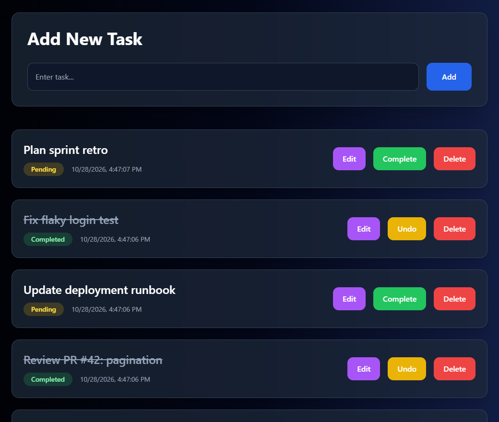
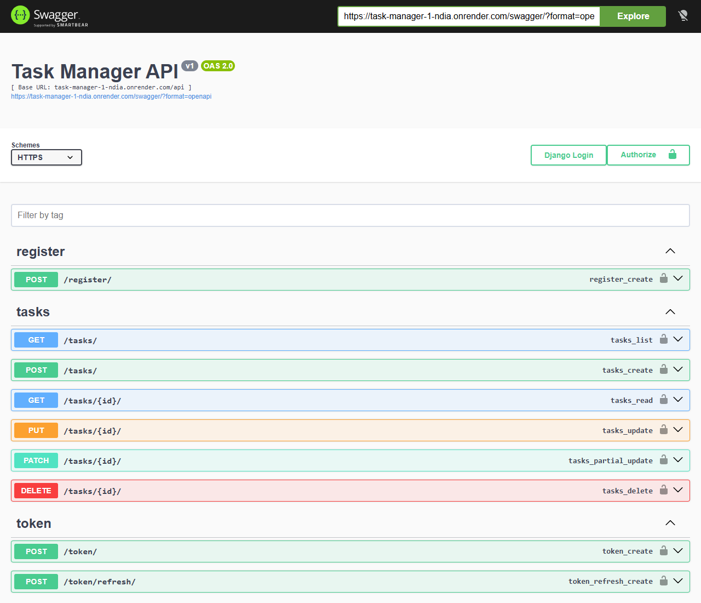
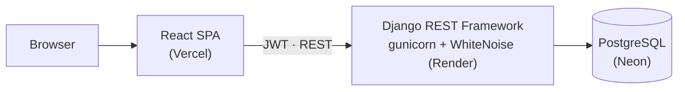

<div align="center">

# ✅ Vector Tasks

**A full-stack task manager: a Django REST Framework API with JWT auth and per-user data isolation, plus a React frontend.**

[](https://github.com/rohantiwari9573/Vector-Tasks/actions/workflows/backend.yml)
[](https://github.com/rohantiwari9573/Vector-Tasks/actions/workflows/frontend.yml)


**[Live app](https://task-manager-theta-nine-54.vercel.app)** · **[API docs (Swagger)](https://task-manager-1-ndia.onrender.com/swagger/)**

<sub>The API is hosted on a free tier, so the first request after an idle period can take up to a minute while it wakes up. Registration is open.</sub>

</div>

<br />

<table>
<tr>
<td width="50%"><p align="center"><sub>Task dashboard</sub></p></td>
<td width="50%"><p align="center"><sub>Self-documenting API (drf-yasg)</sub></p></td>
</tr>
</table>

---

## Features

- **JWT authentication** with SimpleJWT. Clients get an access/refresh token pair and send `Authorization: Bearer <token>`.
- **Per-user data isolation.** Every task query is scoped to `request.user`, so a user can't read, update or delete anyone else's tasks. Another user's task ID returns `404`.
- **Full CRUD** for tasks, with filtering by status (`?completed=true`), title search (`?title=`) and safe ordering through DRF's `OrderingFilter` (`?ordering=-created_at`).
- **Security hardening.**
  - The secret key and debug flag come from the environment, never source code.
  - Passwords pass Django's validators.
  - DRF throttling allows 20 requests/min for anonymous users and 120/min for authenticated users.
- **Operations.** Errors are logged to the console so they show up in the host's logs. The database connection has a 5-second timeout so one stuck connection can't take the site down, and an unauthenticated `/health` endpoint serves uptime checks.
- **React frontend** with protected routes, an error boundary, and create, edit, complete and delete in place.

## API

| Method | Endpoint | Description |
|---|---|---|
| `POST` | `/api/register/` | Create an account |
| `POST` | `/api/token/` | Log in and get access + refresh tokens |
| `POST` | `/api/token/refresh/` | Refresh the access token |
| `GET` | `/api/tasks/` | List your tasks (`?completed=`, `?title=`, `?ordering=`) |
| `POST` | `/api/tasks/` | Create a task |
| `GET` · `PUT` · `PATCH` · `DELETE` | `/api/tasks/{id}/` | Read, update or delete one of your tasks |
| `GET` | `/health` | Liveness probe |

```bash
curl -X POST https://task-manager-1-ndia.onrender.com/api/tasks/ \
  -H "Authorization: Bearer $ACCESS_TOKEN" -H "Content-Type: application/json" \
  -d '{"title": "Ship v2 onboarding flow", "completed": false}'
```

## Architecture



## Getting started

### With Docker

```bash
git clone https://github.com/rohantiwari9573/Vector-Tasks.git
cd Vector-Tasks
cat > .env <<'EOF'
SECRET_KEY=change-me
POSTGRES_PASSWORD=change-me
DATABASE_URL=postgres://postgres:change-me@db:5432/taskmanager
EOF
docker compose up --build        # API on http://localhost:8001, Swagger at /swagger/
```

The container collects static files, applies migrations and starts gunicorn against its own Postgres container.

### Without Docker

```bash
pip install -r requirements.txt
echo "SECRET_KEY=change-me" > .env
echo "DEBUG=True" >> .env
python manage.py migrate
python manage.py runserver       # falls back to SQLite when DATABASE_URL is unset
```

```bash
cd task-manager-frontend
npm install
npm start                        # http://localhost:3000
```

## Deployment and CI

- **Frontend:** Vercel.
- **API:** Render, running gunicorn and serving static files through WhiteNoise.
- **Database:** Neon PostgreSQL.
- **CI:** GitHub Actions runs Django system checks on the backend and a production React build on the frontend, on every push.

## Project structure

```text
taskmanager/            Django project: settings, URLs, health check
tasks/                  app: models, serializers, views, URLs
task-manager-frontend/  React SPA (pages, components, API service)
Dockerfile · docker-compose.yml
```

## Roadmap

- [ ] API test suite (auth, isolation, filtering)
- [ ] Pagination on `/api/tasks/`
- [ ] Priorities and due dates
- [ ] Drag-and-drop board view

## Author

**Rohan Tiwari** · [GitHub](https://github.com/rohantiwari9573) · [LinkedIn](https://www.linkedin.com/in/rohan-tiwari-012106283/)
